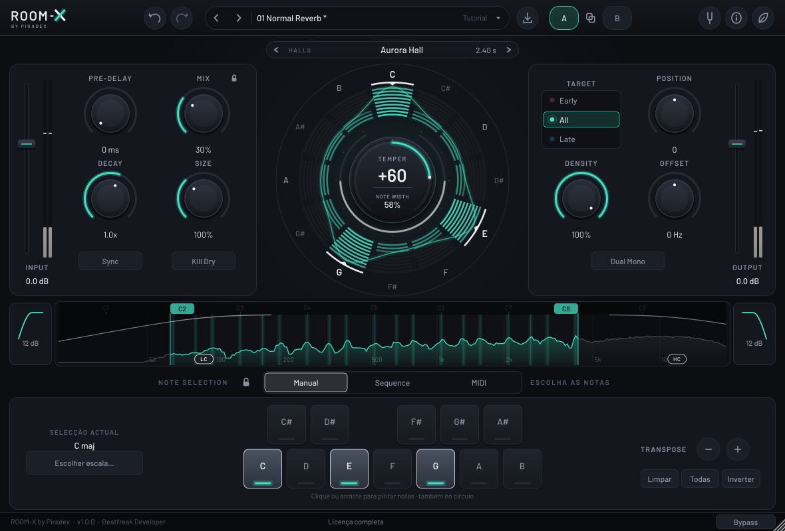

# ROOM-X by Piradex

Reverb modal musical para **macOS (AU + VST3, Universal 2: Intel + Apple Silicon, 10.13+)** e **Windows 10/11 (VST3 x64)**. JUCE 8 / C++17.

Uma reverb de estúdio premium cujo campo ressonante se afina por **notas, acordes, escalas, sequências harmónicas ou MIDI ao vivo**. O **Temper** realça (+) ou escava (−) essas ressonâncias; o **Target** decide se actua nas reflexões iniciais (**EARLY**, coral), em tudo (**ALL**, teal) ou na cauda (**LATE**, azul eléctrico) — e o acento da interface muda de cor com ele.



## Funcionalidades
- Motor híbrido original: reflexões iniciais esparsas + FDN de 16 linhas + banco modal de 121 ressoadores (D#0–D#10). Latência 0. Ver [docs/DSP_ARCHITECTURE.md](docs/DSP_ARCHITECTURE.md).
- **Temper** −100…+100 · **Note Width** 1–99 % · **Target** Early/All/Late · **Temper Range** com pegas por nota (D#0–D#10).
- **Pre-Delay** 0–2000 ms ou sincronizado (1/64 … 1/1, pontuado/tercina) · **Mix** potência constante + Mix Lock · **Decay** 0.01–30x (RT60 efectivo mostrado) · **Size** 50–200 % · **Position** 99 E … 99 L · **Density** 1–100 % · **Offset** −500…+500 Hz · **Input/Output** −60…+12 dB com medidores · **Kill Dry** · **Dual Mono** · **Bypass** sem cliques.
- **Low/High Cut** do wet 20 Hz–20 kHz, 12 ou 36 dB/oct, com arrasto central da banda.
- **NoteScape**: visualizador radial segmentado de energia por nota (original), com buracos visíveis para Temper negativo; clique nas notas para as ligar/desligar.
- **Espectro wet** 20 Hz–20 kHz com zonas das notas, Temper Range e filtros.
- Selecção de notas: **Manual** (12 teclas, pintar por arrasto, Escolher escala: 12 intervalos, 25 acordes, 24 escalas, 13 modos; Transpose; Limpar/Todas/Inverter), **Sequence** (8 linhas, 1–64 compassos, grelha 1/1…1/16 + tercinas, session offset, transpose, retrigger, arm/seguir DAW, criar/mover/redimensionar/duplicar regiões, zoom e navegador) e **MIDI** (todos os canais, sustain CC64, Octave Repeat, release ajustável, medidor de actividade).
- **29 espaços originais** em 5 categorias · **60 presets de fábrica + 11 tutoriais** · presets do utilizador (.roomx), importar, A/B com cópia nos dois sentidos, Undo/Redo, Note Lock, Mix Lock, modo **Eco**, afinação global (A4 400–500 Hz, ±50 cents, sustenidos/bemóis).
- Interface escalável 70–150 %.

## Acesso por senha
Ao abrir o plugin aparece o ecrã de login (mesmo modelo dos outros plugins Piradex):
- **MASTER** — acesso completo, sem validade.
- **BETA** — para beta testers, com data de validade (aparece no rodapé, a laranja).
- **Lembrar este computador** — guarda só um token ligado à máquina (nunca a senha). *Info → Terminar sessão* apaga-o.

Enquanto não houver senha, **o ROOM-X deixa o áudio passar intacto** (bit a bit) — sessões antigas nunca ficam mudas.

O código não contém senhas — só *salt* + hash PBKDF2-HMAC-SHA256 (60 000 iterações). A verificação corre fora da thread de áudio e da UI; 5 tentativas erradas → 30 s de espera. Para criar senhas novas:
```
python3 tools/generate_beta_password.py 2027-03-31        # BETA válida até essa data
python3 tools/generate_beta_password.py --master          # MASTER
```
Cola a linha impressa em `kKeys` (`Source/licensing/License.cpp`) e faz push — o GitHub compila. Nunca escrevas senhas em ficheiros do repositório. A licença está atrás de `ILicenseProvider`, pronta para uma futura conta Beatfreak na nuvem.

## Compilar
O GitHub Actions (`.github/workflows/roomx.yml`) compila tudo a cada push que mexa em `ROOM-X/`:
- testes DSP + testes do plugin (com capturas da interface),
- **macOS**: AU + VST3 Universal 2, verificação `lipo` e macOS mínimo 10.13, `auval` (Apple Silicon e Intel/Rosetta), pluginval, `.pkg` + `.dmg`,
- **Windows**: VST3 x64 sem dependência do VC++ Redistributable, pluginval, instalador Inno Setup + `.zip`,
- publica um pré-lançamento `roomx-v1.0.0-beta` com o `.dmg`, o `Setup.exe` e o `.zip`.

Localmente:
```
cmake -S ROOM-X -B build-roomx -DCMAKE_BUILD_TYPE=Release            # Mac: -G Xcode -DCMAKE_OSX_ARCHITECTURES="arm64;x86_64"
cmake --build build-roomx --config Release --target RoomX_VST3 RoomX_AU
```
Testes:
```
g++ -O2 -std=c++17 -IROOM-X/Source ROOM-X/tests/test_dsp.cpp ROOM-X/Source/dsp/*.cpp ROOM-X/Source/music/*.cpp -o test_dsp && ./test_dsp
cmake -S ROOM-X -B build-test -DROOMX_BUILD_TESTS=ON && cmake --build build-test --target roomx_plugin_test
./build-test/roomx_plugin_test capturas          # ROOMX_TEST_MASTER / ROOMX_TEST_BETA opcionais
```

## Instalação
- **macOS**: abrir o `.dmg` → `ROOM-X by Piradex 1.0.0.pkg` (VST3 em `/Library/Audio/Plug-Ins/VST3`, AU em `/Library/Audio/Plug-Ins/Components`). No Logic, para o modo MIDI carregue-o como *MIDI-controlled Effect*.
- **Windows**: `ROOM-X-by-Piradex-1.0.0-Windows-Setup.exe` instala em `C:\Program Files\Common Files\VST3`. Sem assinatura digital paga, o Windows pode mostrar "O Windows protegeu o seu PC": **Mais informações → Executar mesmo assim**.
- Presets do utilizador: `~/Music/Piradex/ROOM-X/User Presets` (Mac) · `Documentos\Piradex\ROOM-X\User Presets` (Windows).

## Estrutura
```
ROOM-X/
  CMakeLists.txt            projecto JUCE (AU/VST3), testes opcionais
  Source/
    PluginProcessor.*       áudio, MIDI, transporte, estado (sem alocação no processBlock)
    PluginEditor.*          interface 1180×800 escalável
    dsp/                    EarlyReflections, FDNReverb, ModalBank, Processors (Offset, filtros, pre-delay), ReverbEngine, SpaceLibrary
    music/                  MusicTheory (escalas/acordes/afinação), SequenceEngine, MidiNoteState
    state/                  Parameters (IDs imutáveis), PresetManager (A/B, .roomx), FactoryPresets, SequenceModel
    licensing/              License (ILicenseProvider, PBKDF2, token ligado à máquina)
    ui/                     Theme, LookAndFeel, Widgets, NoteScape, SpectrumView, Panels, SequencePanel, TopBar, LoginOverlay
  assets/fonts/             Barlow (SIL OFL 1.1)
  tests/                    test_dsp.cpp (sem JUCE), test_plugin.cpp (integração)
  tools/                    generate_beta_password.py
  installer/                pkg/dmg (macOS) e Inno Setup (Windows)
  docs/                     especificação, arquitectura DSP, UI, plano de testes
```

## Regra de propriedade intelectual
O material de referência (Temperance Pro) foi usado só para estudar o fluxo de trabalho e a taxonomia dos controlos. O ROOM-X usa DSP, geometria, gráficos, marca, espaços, nomes de presets e código originais. Não contém activos, código, dados, IRs, nomes ou tecnologia proprietária da Eventide.

## Licenças de terceiros
- JUCE 8 (licença JUCE / AGPLv3 — ver juce.com).
- Fonte Barlow (SIL Open Font License 1.1, `assets/fonts/OFL.txt`).
- Transformador de Hilbert por passa-tudo: coeficientes de domínio público (O. Niemitalo).
